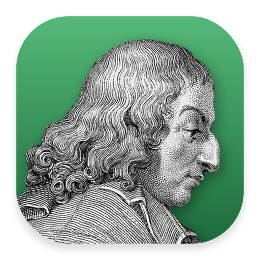
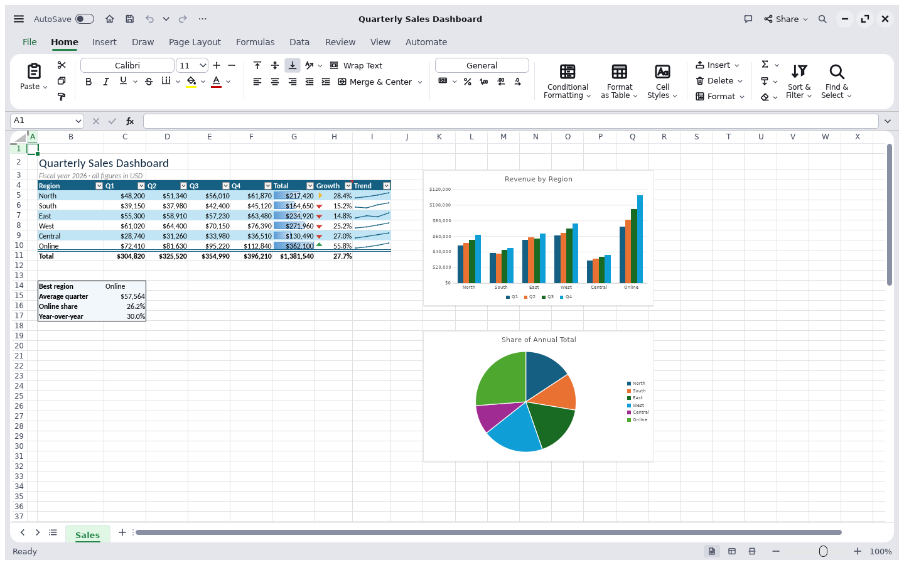
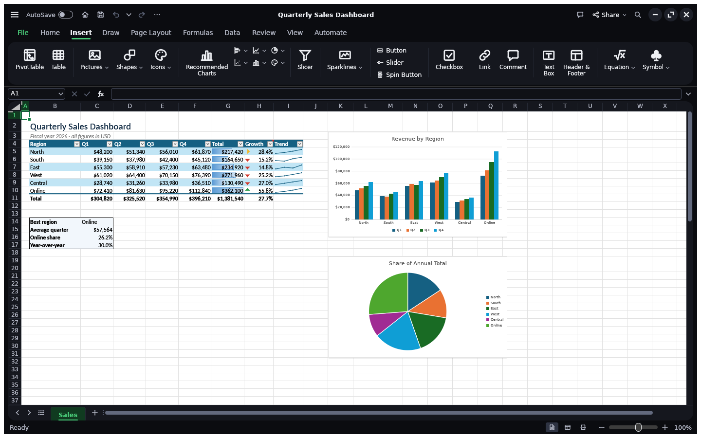
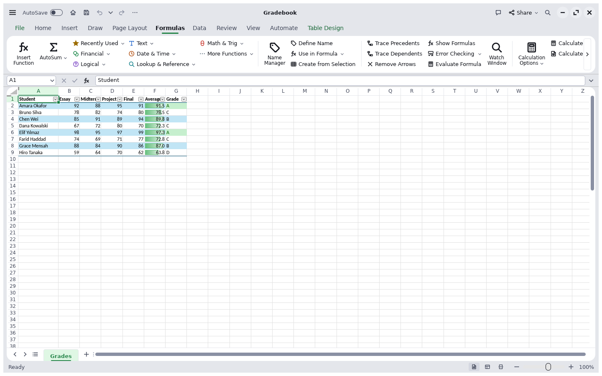
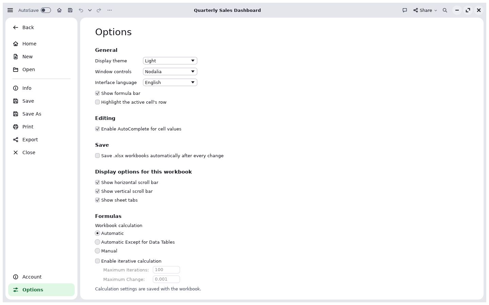
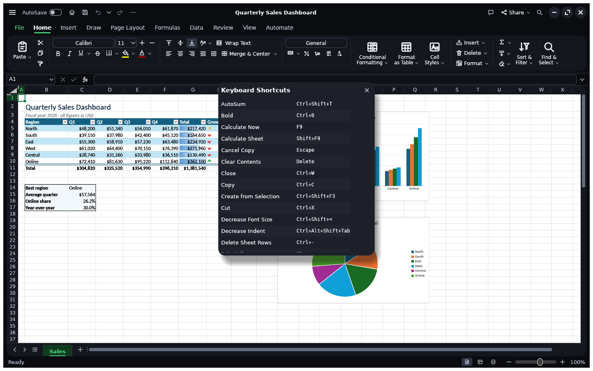

<div align="center">
  <a href="https://getnodalia.com">
    
  </a>
  <br><br>
  
  <h1>Celdas</h1>
  <p><strong>The spreadsheet application of the Nodalia suite.</strong></p>

  <p>
    
    
    
  </p>

  <p>
    <a href="#overview">Overview</a> ·
    <a href="#download">Download</a> ·
    <a href="#build-and-run">Build</a> ·
    <a href="#project-status">Status</a> ·
    <a href="#the-nodalia-suite">Suite</a> ·
    <a href="#license">License</a>
  </p>
</div>

---

## Overview

**Celdas** is the spreadsheet application of [Nodalia](https://getnodalia.com): a native app written in Rust,
with no account and no cloud. It runs on Linux, macOS and Windows.

It opens and saves Excel workbooks (`.xlsx`), with formulas, tables, charts, pivot tables,
conditional formatting and printing, and it is drawn in the Nodalia Design Language in light and
dark.

> [!IMPORTANT]
> **Celdas is at an early stage.** Expect rough edges, and keep a copy of workbooks that matter.

<p align="center">
  
</p>

<table>
<tr>
<td width="50%" valign="top"><p align="center"><sub><b>Dark mode</b> and the Insert tab: tables, charts, sparklines, pictures, shapes, links and comments.</sub></p></td>
<td width="50%" valign="top"><p align="center"><sub><b>Formulas.</b> Hundreds of functions, dynamic arrays, LET and LAMBDA, structured table references.</sub></p></td>
</tr>
<tr>
<td width="50%" valign="top"><p align="center"><sub><b>Preferences</b>, from the main menu: theme, window controls, language and calculation.</sub></p></td>
<td width="50%" valign="top"><p align="center"><sub><b>Keyboard shortcuts</b>, listed for every command.</sub></p></td>
</tr>
</table>

## Download

Packages for Linux, macOS and Windows are on the
[releases page](https://github.com/getnodalia/celdas/releases/latest) and at
[getnodalia.com/celdas](https://getnodalia.com/celdas). The app checks for updates itself.

## Build and run

You need a recent stable Rust toolchain.

```bash
git clone https://github.com/getnodalia/celdas.git
cd celdas
cargo run --release -p celdas
```

## Project status

| Area | State |
|---|---|
| Package and binary names | Done: `celdas`, `dev.danielmiguelt.Celdas` |
| App icon | Done: portrait of Blaise Pascal |
| Nodalia interface | Done: Nodalia theme and icons, rounded islands, main menu, Nodalia window controls on Linux |
| Global menu | Done: the desktop's top bar on Nodalix (Linux), the menu bar on macOS |
| Installable packages | Linux, macOS (DMG) and Windows, with the in-app updater |

## App icon

Nodalia app icons are black-and-white portraits of historical figures over the app colour.
Celdas's is Blaise Pascal, who built the first mechanical calculator. Provenance and licence are in [`assets/app-icon/`](assets/app-icon/).

## The Nodalia suite

Celdas is one of the applications of [Nodalia](https://getnodalia.com), an independent software
project developed in public by [Daniel Miguel Tejedor](https://danielmigueltejedor.com).

## License

`MIT OR Apache-2.0`. See [`LICENSE-MIT`](LICENSE-MIT), [`LICENSE-APACHE`](LICENSE-APACHE) and
[`NOTICE`](NOTICE).
